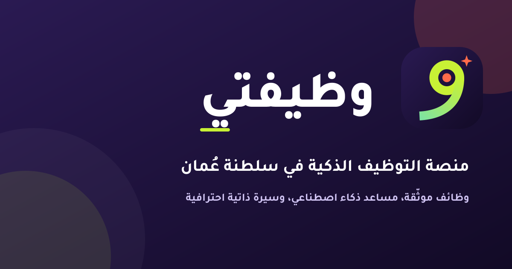

<p align="center"></p>

<h3 align="center">وظيفتي · منصة التوظيف الذكية في سلطنة عُمان</h3>

<p align="center"></p>

## ما هي وظيفتي؟
منصة توظيف عمانية على نمط «يمن اتش ار» مع إضافات ذكية: تقديم ومتابعة داخل المنصة، نسبة مطابقة، مساعد ذكاء اصطناعي، قوالب سيرة ذاتية حصرية، وحماية من الإعلانات الاحتيالية.

## الميزات (النسخة 1.0)

| الدور | الميزات |
|---|---|
| باحث عن عمل | بحث وفلاتر (ولاية، تخصص، نوع، أعمال يومية، للعمانيين فقط)، نسبة مطابقة، حفظ، تقديم ومتابعة الحالة، ملف كامل بالخبرات، 4 قوالب سيرة حصرية مع طباعة PDF، تنبيهات وإشعارات |
| صاحب عمل | نشر وظيفة من 8 قوالب جاهزة أو بالذكاء الاصطناعي من المسمى فقط، قائمة متقدمين مرتبة بالمطابقة، تغيير الحالة، ترشيح أفضل المرشحين بالذكاء |
| الإدارة | مراجعة الوظائف قبل النشر مع فحص احتيال ذكي، توثيق الجهات، تمييز الوظائف، معالجة البلاغات |

### مساعد وظيفتي الذكي ✦
يعمل في كل الصفحات: يبحث عن وظائف بالكلام العادي، يقيّم «هل أناسب الوظيفة؟»، يجهّز للمقابلة، يكتب رسالة التقديم والنبذة المهنية، يكتب إعلان الوظيفة كاملاً، يرشّح أفضل المتقدمين، ويفحص الإعلانات المشبوهة.

يعمل تلقائياً بأحد 3 أوضاع:
1. **داخل Claude:** يستخدم Claude مباشرة.
2. **متصل بخادمك:** عبر دالة `supabase/functions/ai-assistant` (مفتاح الـ API في الخادم فقط).
3. **محلي:** محرك ذكي بقواعد مدمجة، يعمل بدون إنترنت ودون أي إعداد.

## هيكل المشروع
```
index.html                 الواجهة
css/app.css                التصميم والهوية
js/config.js               الإعدادات (رابط الذكاء الاصطناعي و Supabase)
js/data.js                 القوائم والقوالب والبيانات التجريبية
js/ai.js                   المساعد الذكي ومحرك المهام
js/cv-templates.js         قوالب السيرة الذاتية (الخنجر، اللبان، مسقط، الخريف)
js/app.js                  منطق التطبيق والشاشات
assets/brand/              الشعارات SVG
assets/icons/              أيقونات التطبيق PNG
supabase/schema.sql        قاعدة البيانات الكاملة (PostgreSQL)
supabase/functions/        دالة المساعد الذكي
docs/ROADMAP.md            خطة الإطلاق والمراحل
```

## التشغيل
- **محلياً:** افتح المجلد وشغّل `python3 -m http.server` ثم افتح `http://localhost:8000`.
- **على الإنترنت:** كل دفع إلى فرع `main` يُنشر تلقائياً على GitHub Pages (من الإعدادات: Settings ← Pages ← Source: GitHub Actions).

## تطبيق أندرويد (APK)
مع كل تحديث على `main` يُبنى ملف APK تلقائياً عبر Capacitor، ويُنشر في صفحة **Releases** باسم «وظيفتي - تطبيق أندرويد (أحدث نسخة)».

رابط التحميل المباشر: `https://github.com/alialbsese633-blip/wazifati/releases/download/apk-latest/wazifati-v1.0.0.apk`

بناء محلي: `npm install && npm run android:prepare && cd android && ./gradlew assembleDebug`

## تفعيل الذكاء الاصطناعي الحقيقي
```bash
supabase functions deploy ai-assistant
supabase secrets set ANTHROPIC_API_KEY=xxxxx
```
ثم ضع رابط الدالة في `js/config.js` في الحقل `aiEndpoint`.

## الهوية البصرية
| اللون | الاسم | الكود |
|---|---|---|
| 🟪 | ليل ظفار | `#1B1035` |
| 🟣 | بنفسج اللبان | `#2A1A52` |
| 🟩 | ليمون الخريف | `#C8F135` |
| 🟢 | نعناع | `#7FE3A0` |
| 🟧 | مرجان | `#FF6B4A` |

الرمز حرف «و» مبني هندسياً: الحلقة رأس الإنسان ونقطة مرجانية في مركزه، والذيل منحنى صاعد، والنجمة ترمز للذكاء الاصطناعي.

## حالة النسخة 1.0
البيانات في هذه النسخة تجريبية وتُحفظ في متصفح المستخدم. ربط الشاشات بقاعدة Supabase هو المرحلة التالية (انظر `docs/ROADMAP.md`).
